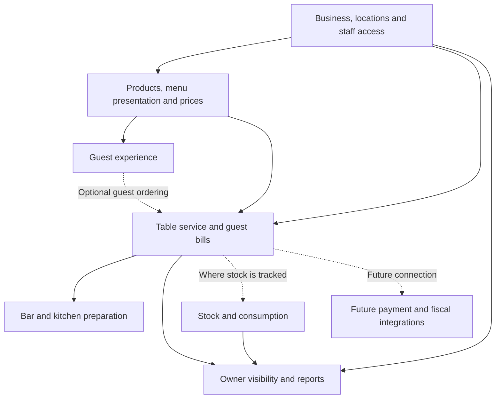

# Hospitality Operations System — first product map

Draft, 10 October 2026. Prepared from the owner's explanation and repository inspection.
This is an editable product definition, not an approved implementation plan or database design.
Tracker: ONM-2, with related questions in ONM-3, ONM-5, ONM-9 and ONM-20.

## Product in one sentence

A Hospitality Operations System that connects in-seat guest ordering with internal service operations and remote owner visibility.

The digital menu is a location's offerings in digital form and can exist on its own. The system's customer side is optional and supports seeing the menu, ordering for delivery to the table, and eventually paying. Home delivery is outside this definition. The operational side is essential to the system.

## Owner's clarified direction — 10 October 2026

- Waiter, Bar and Kitchen are operational states/modes; they must not be treated as mutually exclusive job titles or fixed permission roles. A person can perform more than one function, including a barman taking orders. The exact transitions and permissions still need definition.
- The bar is intended to see the whole order, including food, and coordinate its ongoing service. Kitchen sees the relevant food/preparation portion. Preparation completion, delivery and settlement are distinct concerns.
- Customer-originated orders should participate in the same occupied-table/service experience as waiter-originated orders. Authorized on-shift waiters should be able to enter and settle those bills. How responsibility is assigned when several waiters are working is still unresolved.
- `Naplati` currently records cash/card settlement information. Recording card does not mean the system processed a card payment. Online customer payment and possible phone/NFC banking integrations remain future work.
- Internal scope includes order capture/management, staff, shifts, work per shift, stock and order tracking, plus future integrations. Support-staff operational workflows are outside the current focus.
- Current code differs from this target: it has separate customer-order and waiter-tab flows, enum-like station roles, shared whole-order preparation status, and no established customer-order-to-waiter-bill link. These are product gaps, not silently authorized redesigns.

## Starting evidence and boundaries

- Barista has used the waiter workflow for months. The earliest currently recorded bill is dated 25 May 2026; the 10 October snapshot contains 5,106 bills, of which 5,105 are closed. That is meaningful operational experience, although it does not establish every record's provenance or every other feature's readiness.
- The user describes one active business, generally one waiter operating one device. The immediate planning task is defining the product and release scope, not re-proving that this existing workflow has value.
- Custom authentication and the dedicated self-hosted Supabase schema remain requirements. Supabase Auth must not be introduced.
- Database redesign is deferred. The conceptual map below does not prescribe tables, migrations or a tenancy hierarchy.
- Fiscal/cash-register integration is a future connection to a separate provider, according to the owner's intended product boundary. This document makes no legal determination.
- The owner wants a broader SaaS release soon. No release date or readiness claim is established by this draft.

## How the parts connect

Arrows represent intended business relationships. They do not claim that current code implements a unified order flow: customer orders and waiter tabs currently use separate paths.

## The six product areas

| Area | What it does for someone | What belongs here |
|---|---|---|
| Guest experience | Lets a guest understand what is available and, optionally, request it | Digital menu, categories, languages, product details; optional table ordering; future payment |
| Table service | Helps staff keep track of a guest's ongoing visit | Physical table selection, active bill, additional rounds, held/sent items, settlement, preparation handoff |
| Catalog and presentation | Lets a business describe and price what it sells | Products, options, categories, dine-in/takeaway offers, happy hour, menu appearance and content |
| Owner visibility | Explains what happened and who handled it | Current activity, recorded sales by period, bill history, shift and waiter breakdowns |
| Stock and consumption | Explains quantities remaining where tracking is useful | Counted packaged goods; potentially ingredients, recipes or prepared batches later; adjustments and consumption history |
| Business and staff setup | Defines where operations happen and who can do what | Business/location relationship, staff access, roles/groups, physical table setup, operating hours and shift assignments |

These are product areas, not a proposed sidebar. Existing navigation labels do not have to dictate the product model.

## Definitions that remove current ambiguity

These are proposed working definitions, to refine against actual service practice.

| Term | Meaning |
|---|---|
| Physical table | A configured seating/service position. It persists across guest visits. |
| Guest bill / tab | The running record for a visit. It can remain open through several rounds of ordering. |
| Finish entering a round | Leave the current entry interaction. This does not mean the guest has paid or the bill is settled. |
| Send to preparation | Make selected items actionable for the bar/kitchen. Whether this coincides with finishing a round is a workflow decision. |
| Settle the bill | Record the end of the outstanding bill under the chosen settlement rules. This is distinct from issuing a fiscal receipt or processing an online payment. |
| Product | What is sold, with its relevant choices. Its precise identity needs agreement before deduplicating data. |
| Menu offer | How a product is presented and priced in a context, such as dine-in, takeaway or happy hour. This distinction is proposed; it is not consistently modeled today. |
| Stock item | What is physically counted or measured. It need not be the same unit or record as the sold product. |
| Shift report | A summary attributed to a defined shift, with a separate breakdown by waiter. Attribution rules remain to be decided. |

Example: recording 40 espressos sold is possible without tracking beans. Tracking beans would additionally require a consumption rule, units and adjustments. Repeating an espresso in a menu section should not automatically imply a separate physical supply.

## First release discussion — proposed boundaries

This table is a starting position for discussion, not a declaration that the included capabilities are finished or that deferred capabilities are unwanted.

| Candidate boundary | Capabilities | Evidence/condition |
|---|---|---|
| Main offer | Configurable digital menu; waiter table bills; remote owner visibility into recorded activity and sales | These match the stated value and existing pilot. Define exactly what an owner can rely on and address relevant known correctness/access defects. |
| Include only with explicit limits | Shift/per-waiter reports; stock for straightforward counted products; preparation screens | Existing code varies in maturity. Decide which is needed by the first new customers; specify supported behavior before making sales claims. |
| Do not promise in the first offer unless deliberately added | Online payments; fiscal-system handoff; ingredient/recipe inventory; full restaurant kitchen workflow; advanced multi-location/group administration; guest self-ordering | These are incomplete, unvalidated in the current pilot, or still conceptually undecided. Their eventual priority can change with customer needs. |

Known credential/venue-access defects are corrective work, not optional product modules. The existing inspection provides the evidence; this draft does not reproduce the entire defect backlog.

## What to define next

The first decision is the promise made to the next customer. A candidate is:

> Your guests can browse your menu, your waiters can keep track of table bills, and you can see recorded sales remotely, including the staff breakdowns your business needs.

The staff-breakdown clause needs a precise definition before it becomes a release promise. This wording deliberately does not claim automatic payment collection, fiscal receipts or comprehensive inventory accounting.

After choosing that promise, define only the areas it depends on. Each area can use the same small card:

- **Purpose:** what the person needs to accomplish.
- **Normal flow:** what starts it, what the person does, and what ends it.
- **Meaning of records:** what is counted, attributed or changed.
- **Connections:** which other areas are affected.
- **Release boundary:** included now, explicitly limited, or later.
- **Open decision:** a question whose answer changes behavior.

Crossing a shift while a bill remains open is one such question. Menu-offer identity versus stock identity is another. They need answers when their area is selected; they do not all need to be resolved before product mapping can begin.

## How to maintain this draft

The owner supplies domain judgments, exceptions and corrections. The agent maintains the map, definitions and implications in this document and the tracker. A correction can be as small as a sentence or an annotation; it does not require the owner to rewrite a specification.

No application behavior or live data was changed to produce this map. Unresolved choices must remain visible rather than being silently turned into implementation assumptions.
