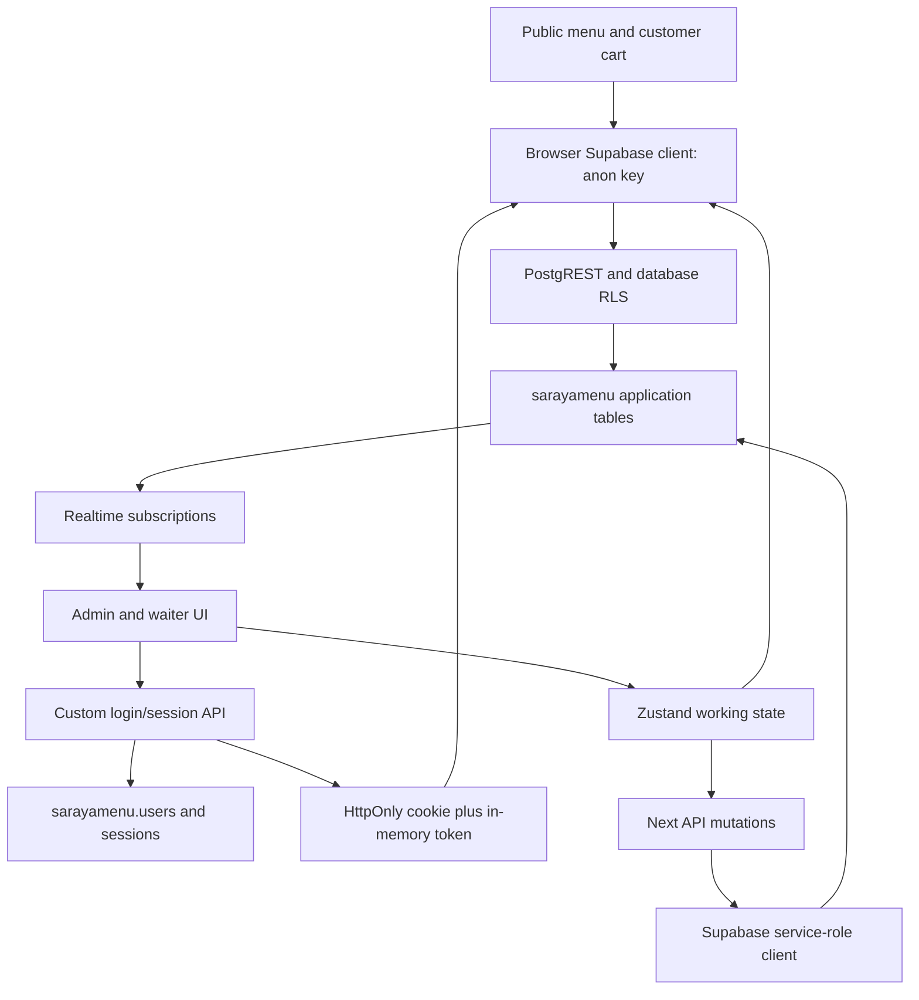

# Repository inspection — 10 October 2026

Inspection of commit `9a0652f`, prepared before the next product changes. This is a dated architecture and evidence snapshot derived from source and the tracker; `tracking.db` and `TRACKING_GUIDE.md` remain the maintained technical memory. See `REPOSITORY_FILE_MAP.md` for the complete source index.

## Scope and evidence

- Inventoried all tracked project files, parsed all 131 TypeScript/TSX source files (33,329 lines), and traced routes, handlers, services, stores, and database calls. Reviewed configuration, SQL scripts, deployment, PWA, styles, theme presets, and documentation drift.
- Read `.env` privately. Confirmed a self-hosted HTTPS Supabase endpoint and the explicitly configured **`sarayamenu` schema**. No credentials are reproduced here.
- Read the live schema's PostgREST metadata and made bounded read-only data/count requests. Did not create a session, change a PIN, write a sale, run migrations, change production data, or deploy.
- Installed the npm lockfile dependencies locally with install scripts disabled; production build passed. Local HTTP smoke checks passed for public/login HTML and unauthenticated API boundaries. These are not browser interaction tests.
- Executed local, isolated fixtures for product mapping, cart-store subscriptions, happy-hour boundaries, and theme configuration. Ran a separate React hooks lint rule over all typed source.
- SQL function bodies, the complete deployed RLS policy set, triggers, indexes, grants, Realtime publication configuration, and infrastructure-level rate limits were not available through the exposed metadata. No claim of a complete live authorization audit is made.

**User constraint:** authentication is app-owned. Do not introduce Supabase Auth or migrate accounts into `auth.users`. The dedicated schema and custom login are intentional architectural requirements.

## 1. What the application is

Saraya is a multi-venue digital menu and restaurant operations application. One Next.js application hosts the public venue directory and menus, configurable menu presentation, customer QR checkout, an administrative workspace, waiter table accounts, bar/kitchen boards, inventory, and shift scheduling/reporting.

The current architecture is substantially newer than the original documentation. Business data is in Supabase Postgres. Most browser screens use Zustand as an in-memory working model. Browser storage is used for selected preferences and session conveniences, not as the main business database.

| Layer | Actual implementation |
|---|---|
| Application | Next.js 14.2.35 App Router, React 18.3.1, TypeScript 5.9.3 |
| UI | Tailwind 3, Framer Motion, Lucide; extensive theme-driven client components |
| State | Zustand 5.0.11; separate CMS, auth, cart, table-session, language, and admin stores |
| Data | Supabase JS; npm lock resolves 2.106.0, though package.json declares `^2.49.8` |
| Authentication | Custom API routes, bcrypt credentials, opaque app sessions |
| Live updates | Supabase `postgres_changes` subscriptions for orders/tabs/items |
| Assets | Public Supabase Storage bucket `sarayamenu` |
| Deployment | Production-branch GitHub Action → SSH → pnpm build → PM2, port 3017 |

There is no middleware file, background job system, payment-provider integration, receipt engine, or checked-in automated test suite. The `scripts/` directory contains manual SQL changes and a source-rewriting utility, not a complete database bootstrap.

## 2. Runtime and trust boundaries

`src/lib/supabase.ts` disables Supabase Auth persistence, refresh, and URL detection. Its custom fetch adds `x-sarayamenu-session` when an app token is present. The anon database role therefore does not mean the application user is necessarily anonymous: the custom header is intended to supply app identity to database policies.

`src/lib/supabase-server.ts` uses `SUPABASE_SERVICE_ROLE_KEY`. That bypasses RLS, so API handlers must authorize the target venue and resource themselves. A valid cookie alone is not a venue permission check.

Both clients select the schema using `NEXT_PUBLIC_SUPABASE_DB_SCHEMA`, falling back to `sarayamenu`. Type definitions and generic client types are specifically written for `sarayamenu`. The storage bucket is a separate, hard-coded `sarayamenu` setting.

The frontend is predominantly client-rendered. Public pages wait for browser-side venue loading; admin pages restore their session and then load venue data. The successful server HTML smoke checks establish route availability, not that the browser has completed data hydration.

## 3. Route map

| Route | Purpose and principal dependencies |
|---|---|
| `/` | Venue directory; loads all venue bundles, searches name/slug/type |
| `/[venue]` | Theme-driven menu, categories/search, happy-hour prices, QR session hint, order bar |
| `/[venue]/product/[id]` | Product customization, dependent options/addons, quantity and cart composition |
| `/[venue]/cart` | In-memory cart review and quantity changes |
| `/[venue]/checkout` | QR table requirement, note/payment-method selection, direct `orders` insert |
| `/admin/login` | Email → password/invite activation, remembered-user PIN login, PIN reset |
| `/admin` | Platform venue dashboard, venue creation/deletion, summary counts |
| `/admin/[venue]` | Venue entry/redirect based on role; also contains venue login UI |
| `/admin/[venue]/restaurant` | Restaurant identity, descriptions, contact info, asset uploads |
| `/admin/[venue]/products` | Products, integrated categories, options/dependencies, happy hour, inventory flags |
| `/admin/[venue]/categories` | Separate category editor; mostly duplicated by the product screen |
| `/admin/[venue]/page-content` | Text, colors, layout, themes, section ordering and iframe preview |
| `/admin/[venue]/settings` | Ordering toggle stored as `componentStyles.viewOnlyMode` |
| `/admin/[venue]/orders` | QR orders plus closed waiter tabs, dates, analytics, detail modals and CSV |
| `/admin/[venue]/tables` | Table label/capacity, soft deactivation, QR download/print |
| `/admin/[venue]/waiter` | Table floor, open tabs, stale-empty cleanup, backlog activation, logout |
| `/admin/[venue]/waiter/[tabId]` | Add/remove tab items, fired/backlog mode, activation, cash/card close, exit |
| `/admin/[venue]/bar` | Customer order board plus fired waiter-tab items; sound/fullscreen/wake-lock helpers |
| `/admin/[venue]/kitchen` | Customer order board in kitchen mode; no waiter-tab board |
| `/admin/[venue]/inventory` | Stock balances, manual adjustment, movements, daily report |
| `/admin/[venue]/shifts` | Weekly operating hours/segments, dated staff rosters, history and sales summaries |
| `/admin/[venue]/users` | Platform-admin user invitation, venue roles, deletion, PIN reset codes |
| `/admin/[venue]/restaurants` | Redirect to `/admin` |

Legacy routes `/admin/restaurant`, `/admin/products`, `/admin/categories`, and `/admin/page-content` still compile as real pages. They are older editors of the flat CMS store and lack the newer explicit cloud-save calls. They are not equivalent aliases of the venue routes. The parent layout can also interpret their second path segment as a venue slug.

## 4. Custom authentication, step by step

### Email and invitation login

1. `AdminLoginForm` posts an email to `/api/auth/login-mode`. The email is trimmed/lowercased.
2. The server looks up `sarayamenu.users` with its service-role client. A bcrypt password selects password mode; an unexpired invite selects invite mode; otherwise it returns `not_found`.
3. Password login verifies bcrypt at cost 10. Invite activation verifies a six-digit SHA-256-hashed code, requires a password of at least eight characters, stores its bcrypt hash, and clears invite fields.
4. `createAuthSessionResponse` generates 32 random bytes encoded as hex, stores the SHA-256 hash in `sessions`, and sets expiry to seven days.
5. The response sets `sarayamenu_session`: HttpOnly, SameSite=Lax, path `/`, Secure in production. It also returns the raw token in JSON so browser PostgREST requests can carry the custom header.
6. `authService` puts the token in module memory. `mapApiUserToAppUser` maps safe public user columns and restaurant access rows into `authStore`.
7. The login screen records the user's identity in local login history, then redirects to the platform dashboard or first venue.

Invitations are copyable codes displayed to the administrator; the application does not email them. They expire after seven days. Account activation and session creation are separate writes, not one transaction.

### Restore and logout

`useAdminSession` calls `/api/auth/session`, which reads the cookie, hashes it, checks an unexpired session, fetches the user and venue roles, and returns the token again. Both outer and venue admin layouts use this hook. `useDbUsers` separately refreshes the auth store's users/access list through browser RLS.

Logout deletes the matching session hash and clears the cookie. The browser service clears its in-memory token after the logout fetch resolves, and screens clear `authStore`. Some UI callers swallow network errors; consequently local logout and server revocation are not guaranteed to succeed together. Expired-session cleanup is not implemented in this repository.

The token's return in JSON is an intentional part of the custom-header architecture; HttpOnly alone does not keep the session bearer token inaccessible to browser JavaScript.

### PIN flows

- `AdminQuickLogin` shows at most five locally remembered identities and calls `/api/waiter/pin-login` with user ID and a three-digit PIN. Successful PIN login creates the same full seven-day app session as password login; it is not a limited waiter capability.
- `/api/admin/users/pin-reset` issues a six-digit reset code valid for 30 minutes. Platform admins may target users; venue owners must provide a venue and the target must belong to it.
- `/api/auth/reset-pin` verifies the reset code and writes a bcrypt PIN hash, clearing the code. Existing app sessions are not revoked by this operation.
- `/api/waiter/set-pin` and `/api/waiter/verify-pin` are older signed-in helper endpoints. `WaiterPicker` calls them and stores a separate local waiter identity, but that component is not imported by the current routed UI.
- `useWaiterIdleTimeout` defines a nine-minute warning/ten-minute timeout, but is also unused. The old local waiter identity has an eight-hour TTL; that is not the expiry mechanism of the current app session.

The active waiter floor identifies its waiter from `authStore.currentUser`, not from the legacy local waiter-session object. “Gotovo” on a nonempty tab logs the current user out while leaving the tab open. “Završi smjenu” is also logout; neither operation records a clock-out in the shift tables.

### Authorization model and drift

Platform roles are `admin` and `user`. Venue roles are `owner`, `manager`, `kitchen`, `bar`, and `employee`. There is no separate waiter role or implemented user-group model.

| Capability in permission helpers | Owner | Manager | Employee | Kitchen | Bar |
|---|---|---|---|---|---|
| CMS/settings | Yes | Yes | No | No | No |
| Orders/waiter | Yes | Yes | Yes | No | No |
| Tables/shifts | Yes | Yes | No | No | No |
| Inventory | Yes | No | No | No | No |
| Kitchen | Yes | Yes | No | Yes | No |
| Bar | Yes | Yes | No | No | Yes |
| Staff helper | Yes | No | No | No | No |

Platform admins pass all these helpers. Actual staff UI is stricter: it is platform-admin-only. Invitation API allows venue owners/managers when a venue is supplied; PIN-reset API allows owners. These are three different access definitions.

The main admin layout primarily filters navigation. It does not enforce every page capability before rendering children, and the venue layout synchronizes venue data without a complete membership gate. Hiding links is not server authorization. Browser mutations depend on RLS; service-role mutations depend on explicit route checks.

## 5. API map and authorization boundaries

All paths below are relative to `/api`.

| Endpoint | Method | Actual gate/behavior |
|---|---|---|
| `auth/login-mode` | POST | Public email lookup; returns name and login mode for recognized accounts |
| `auth/login` | POST | Public credential/invite verification; creates app session |
| `auth/session` | GET | Cookie → session hash → user/access; anonymous response has null user/token |
| `auth/logout` | POST | Deletes cookie's session, clears cookie |
| `auth/reset-pin` | POST | User ID + reset OTP + new PIN |
| `waiter/pin-login` | POST | Public user ID + PIN; creates full app session |
| `waiter/set-pin` | POST | Any valid session; **no target-user authorization** |
| `waiter/verify-pin` | POST | Any valid session; verifies requested user's PIN |
| `admin/users/invite` | POST | Session; platform-admin check for admin invitations; venue owner/manager check only if restaurantId supplied |
| `admin/users/pin-reset` | POST | Platform admin or target-venue owner with target membership |
| `venue/save` | POST | Session only; saves supplied complete venue bundle with service role |
| `upload` | POST | Session only; validates placement/nonempty file; service-role storage upload |
| `[venue]/import-menu` | POST | Session only; merge/replace menu and initialize inventory |
| `inventory/adjust` | POST | Session only; creates/adjusts stock via service role |
| `tabs/close` | POST | Session only; validates payment label, closes arbitrary requested tab |
| `tabs/closed` | GET | Platform admin or owner/manager/employee in requested venue |
| `tabs/discard-empty` | POST | Own tab or admin/venue owner/manager; scoped stale cleanup; verifies emptiness before delete |
| `shifts/schedule` | GET/PUT | Platform admin or requested-venue owner/manager |
| `shifts/roster` | GET/PUT | Same requested-venue gate |
| `shifts/history` | GET | Same requested-venue gate |
| `shifts/summary` | GET | Same requested-venue gate |

Top-level shift venue checks are present, but supplied segment IDs are not consistently bound to that venue in the service layer. Invitation without restaurantId skips the venue-authority branch. These are resource-validation gaps inside the existing custom auth design, not reasons to replace it.

There is no application-code throttling or attempt lockout for password, PIN, invite, or reset-code verification. Whether the deployment proxy supplies any protection was not established. Request validation is mostly ad hoc TypeScript-shaped JSON; compile-time types do not validate arbitrary request bodies.

## 6. CMS, persistence, and themes

### Loading

`loadVenueBundle` fetches restaurant, full menu, page content, component styles, layout configuration, and theme customizations in parallel. Product loading additionally fetches addons, variations, and options. `buildRestaurantData` converts snake_case fields, numeric prices, and JSONB settings into a `RestaurantData` bundle, adding virtual “all” and “popular” categories.

`cmsStore` has two representations: `allRestaurants[slug]` and flat active fields (`restaurant`, `products`, `categories`, content/styles/layout/customizations). Switching venues copies between these representations. Public venue loading also writes the same flat fields. This shared model is a major coupling point for future work.

`ensureVenueLoaded` only fetches when the bundle is absent from the map, then activates it. It does not refresh an already cached venue. The directory and admin boot load all venues and their full bundles; per-venue bundle errors are logged and the failed venue is omitted. A legacy `saraya-cms` localStorage migration may run when the restaurant query returns no rows.

### Saving

Venue editors mutate the flat store, then call `saveActiveToAllRestaurants(slug)`. It snapshots the complete active bundle and queues a 600ms-debounced POST to `/api/venue/save`.

The server then:

1. Creates or updates the restaurant row.
2. Upserts content, styles, and layout in parallel.
3. Upserts saved theme customizations.
4. Deletes absent categories and upserts the desired categories.
5. Deletes absent products.
6. For every product, checks whether it exists, creates/updates it, deletes/reinserts addons, and deletes/reinserts variations/options.

This is a complete-bundle synchronization operation with many HTTP/database calls, even for a small text change. It is neither transactional nor serialized against already in-flight saves. UI “saved” indicators generally mean that a save was queued, not that the server finished it. Errors go to the console. There is no revision check, merge conflict handling, durable retry queue, or unload flush.

Creation differs: `cmsStore.createRestaurant` calls `saveVenueToCloud` directly through the browser client without awaiting it. The dashboard simultaneously assigns the creator an owner role, which can race restaurant creation. Deletion also optimistically removes local state while cloud work is unawaited.

### Product model

Products have globally addressed text IDs; categories are addressed by restaurant plus category ID. However, `products.category` is a string that existing UI frequently treats as the category **label**. Seed creation uses the ID. Live read-only inspection found 79 of 85 products matched a label, and six matched an ID. Renaming category labels does not update product buckets, and label-based grouped rendering can omit products stored under IDs.

Options support required/min/max selection, addon group IDs/labels/min/max, multiple addon quantities, and dependency on a variation option. The public product page filters visible options/addons and calculates a unit-price snapshot; cart identity combines product ID and selected options/addons. Quick-add only checks the `required` variation flag, not all newer minimum-selection constraints.

`getFullMenu` and `getFullProduct` omit `station` when mapping database rows into CMS products. Public cart creation defaults a missing station to kitchen, waiter insertion defaults it to bar, and saving a missing station defaults it back to kitchen. The station round-trip defect was reproduced using a local bar-product fixture. The inspected live snapshot currently has all 85 database products marked kitchen; no historical cause is asserted.

Addon/variation reads in `getFullMenu` do not check their returned errors; failed reads can look like empty configuration. A subsequent complete-bundle save may then replace existing configuration with that empty result. Option replacement also ignores several delete errors. The intended missing-column fallback inspects `Error` or `String(error)`, which may miss `.message` on plain PostgREST error objects.

### Presentation and preview

There are 20 distinct theme presets, verified by loading the local definitions. Defaults select `bella-classic`, with ordering enabled. `custom` is a type option rather than a twenty-first preset.

The layout controls hero, information, promotion, search, category, featured, menu, social-proof, and footer sections. Content/styles/layout are separate JSONB documents. Theme switching remembers per-theme overrides. The page-content editor stages drafts locally; save copies drafts into the store and queues the cloud bundle.

`LivePreview` renders `/<slug>?preview=1` in an iframe, sends the current bundle through `postMessage`, and scales phone/tablet frames. The public layout skips cloud loading for that preview parameter. `useCmsData` listens for preview payloads in an iframe and merges fallback defaults. Message handlers use wildcard targets and do not validate source/origin.

Translations use English base fields with optional `_bs` fallbacks and a persisted EN/BS preference. Several operational labels and currency displays remain hard-coded; for example customer-order station prices use euros while waiter/inventory/report screens use KM. Changing the CMS currency does not change all operational displays.

## 7. Customer order flow

1. QR links are built from the venue slug and a normalized **table label** in `?table=`. The label is not a signed table credential or table-row ID.
2. Public layout stores that value in `sessionStorage` for 45 minutes and checks expiry on a minute interval.
3. Menu/product pages apply happy-hour overrides and add selected product snapshots to the in-memory cart.
4. Checkout requires a valid table session, accepts a kitchen note and payment-method label, and directly inserts a complete `orders` row through the browser Supabase client.
5. Order items, prices, totals, count, and table label come from browser state. There is no server-side order-pricing/QR-validation route in the repository. Any database-side enforcement would need separate SQL inspection.
6. On success, checkout clears the cart and table session and shows a local confirmation timeline. That screen is not subscribed to the actual kitchen preparation state.
7. `useOrders` loads orders and applies Realtime inserts/updates/deletes to the admin state. Both stations advance one shared order status: pending → preparing → ready → served; cancellation is handled in order management.

The cart and table-session stores have no venue key. Navigating between venues in the same browser can carry old items/table context to a new venue. Cart items do not carry restaurantId for submission validation.

The floating `OrderBar` subscribes to stable getter functions, not items or derived totals. An isolated store fixture confirmed adding an item changes the items reference but does not change those function selectors. Thus a cart update alone does not schedule its render.

Checkout catches order submission errors without displaying a message (ONM-6). Its view-only early return also precedes five `useState` calls, confirmed by a React hooks-rule check. If the flag changes across renders, hook order can break. The ordering switch is a UI setting, not a demonstrated database authorization rule.

Payment labels are not payment processing. Online/card checkout is presented as unavailable; waiter card closure records a method, with no charge operation or provider reference. Receipts/accounting are still design work under ONM-5.

## 8. Waiter tabs, Deferer, and stations

### Waiter lifecycle

The floor loads active tables and open tabs. Before refresh it asks `/api/tabs/discard-empty` to clean permitted stale empty tabs older than two minutes. It separately fetches waiter backlog, which internally loads open tabs again.

Tapping a free table confirms then creates `table_tabs` with the current app user as waiter. Existing tabs belonging to that waiter are editable; other waiters' tabs are opened with `readonly=1`. The tab screen also checks ownership/status locally. The service itself relies on browser RLS for direct mutations.

`addItemToTab` searches by tab, product, and fire status. It increments a matching row's quantity using its existing unit price, or inserts a new row. It recalculates the parent total afterward through a separate read/update. Add operations therefore have read/modify/write races, and a partial failure can leave item data and parent total inconsistent. Different price periods merged into an existing row retain that row's first price.

Removing an item removes the whole row, not one unit. The waiter flow does not offer the customer product-customization UI; tab items store base product ID/name/quantity/price/station rather than addon/variation selections.

Cash/card close calls `/api/tabs/close`. The server checks that the tab is open, marks it closed, then deducts tracked inventory. It does not create a customer `orders` row. Closing while items remain in backlog still charges/deducts those items.

### Deferer

Items use `fire_status = backlog | fired` and `fired_at`. Both states count toward total. Waiters choose “Pošalji odmah” or “Odgodi”; activation is available per tab or through a multi-tab floor sheet. Activation changes selected item rows to fired in batches of 75 IDs.

Live metadata confirms both columns exist. This resolves the old tracker's uncertainty about column presence, but does not establish that the full migration/index was applied exactly as written or that the two-device demonstration passes.

There are two distinct unresolved problems:

- A fired row and backlog row for the same product can coexist. Activating the latter produces two fired rows. The next `addItemToTab(...fired)` expects `maybeSingle()` and can fail because both match. No activation consolidation is implemented.
- The bar's “Jasno” stores the entire tab ID in sessionStorage. Later items or activation on that same tab remain hidden. This was already identified as P1 in `DEFERER-PLAN.md` and is still present.

### Station behavior

`StationOrdersBoard` handles customer `orders`. Kitchen shows kitchen/both items without prices; bar shows bar/both plus expandable food context. Status is shared at order level, so stations do not maintain independent preparation states.

`BarActiveTabs` separately renders only fired bar/both waiter items. It first loads enriched open tabs/items and then reloads each tab's details, generating redundant requests. It has no persisted per-item acknowledgement. There is no corresponding waiter kitchen-tab board.

The bar chime watches new **customer orders**, not new waiter fired items. Fullscreen, screen wake lock, orientation, and sound helpers are best-effort browser behavior. `useOrders.reconnect()` changes a key used by the data-fetch callback, but the subscription effect only depends on restaurantId; its name overstates what it does.

Realtime wiring deserves an authenticated runtime check: the custom token is attached by fetch, while no explicit custom session identity is configured on the Realtime channel in application code. Whether deployed Realtime can evaluate the app's policies correctly was not proven. Tab-item subscriptions also have no venue filter, although the resulting row visibility still depends on Realtime/database authorization.

## 9. Inventory and analytics

Inventory holds one balance per venue/product, an optional low-stock threshold, unit, and tracked flag. Movement rows record delta/reason/tab/waiter. Tracking changes write a separate audit row; audit failure is surfaced as a warning after the flag succeeds.

Manual adjustments use the service-role API. Other inventory CRUD and tracking changes go directly through the browser client. Closing a waiter tab deducts each tracked existing product sequentially. Customer QR order submission/status changes do not call inventory deduction.

Current consistency limits:

- Balance update and movement insertion are separate operations. Concurrent adjustments can overwrite one another; partial failures can leave balances without matching history.
- Initializing an existing inventory row with zero uses upsert and resets its balance. Menu import initializes every imported/new product, including replacement-mode products.
- A positive adjustment for a missing row creates the row but does not record that initial movement. Some missing-row negative-insert errors and deduction lookup errors are ignored.
- Product creation queues its cloud save but starts inventory initialization immediately; foreign-key dependencies can race.
- Daily inventory “starting stock” is current balance plus sold quantity, without reversing manual receipts/removals; it is not a full opening-balance reconstruction.

The orders dashboard combines QR orders with closed waiter tabs. The authenticated closed-tab API exists specifically to provide correctly enriched waiter names to venue order viewers (ONM-12). Top products aggregate by product name, not stable product ID.

Dashboard revenue currently includes cancelled QR orders; shift summary excludes cancelled orders. Dashboard “week” is today plus the previous seven calendar dates, not a Monday-start week. Closed-tab load errors become an empty array plus console warning. CSV values are not consistently escaped for commas/quotes or spreadsheet formulas.

Most history services do not paginate. **Observed:** a service-role `table_tabs?select=id` request returned 1,000 rows; an exact count showed 5,106. Date filters reduce exposure for some screens, but any qualifying set larger than the cap is incomplete. Batching item queries by 75 tab IDs prevents long URLs but does not guarantee that each batch stays below the row cap. Shift summaries also use an unbatched `.in(tabIds)` call.

## 10. Shift scheduling and history

Weekly hours use ISO weekdays 1–7. A day has operating hours, closed/open state, and ordered shift segments. UI change-times derive contiguous segments; service validation checks end-after-start, containment, and overlap. Overnight hours are not supported by this model.

`day_shift_segment_assignments` supplies an older recurring assignment template. The current UI writes dated assignments in `shift_date_assignments`, plus a `shift_daily_roster` marker that distinguishes explicitly saved empty rosters from unsaved days. Only manager/kitchen/bar/employee venue staff are assignable; owners are excluded.

Summary loads closed tabs by `closed_at` and noncancelled QR orders by `created_at` within a segment's time window. It reports totals, cash/card, waiter/table breakdowns and top products. All venue sales in the window are included; summary does not filter sales to only the staff roster. The roster is context, not proof of clock-in or assignment enforcement.

Important boundaries:

- `saveDaySchedule` updates supplied segment IDs using only `.eq('id', segmentId)`, with a service-role client, after authorizing the caller's submitted venue. It does not prove those segment IDs belong to that venue.
- Roster assignment and summary paths likewise need segment-to-venue/day checks. `getSegmentById` fetches globally and includes template assignment details.
- History is reconstructed from today's weekly segment definitions. Editing times changes historical windows; deleting segments cascades dated assignments under the checked-in SQL. There is no immutable schedule snapshot.
- Server summaries construct timestamps with the server's local timezone. Browser reports use device-local dates, and inventory custom ranges use UTC `Z`. No explicit venue timezone is stored/configured. Adjacent summaries use inclusive end bounds and can count boundary sales twice.
- Multi-step schedule/roster saves are not transactions. The metadata marker is written after assignment changes, so partial failures can leave a partially changed day.

## 11. Live database observations

The inspected PostgREST schema exposes 27 application tables to service role. Every live table name and Row column name was present in the local TypeScript table definitions; this comparison does not verify column types, nullability, indexes, policies, triggers, or relationships. The file's own comments identify the types as hand-written, despite its “Auto-generated” heading.

| Domain | Tables | Observed row counts |
|---|---|---|
| Accounts | users, sessions, restaurant_access | 8, 97, 6 |
| Venue/menu | restaurants, categories, products | 3, 13, 85 |
| Options | addons, variations, variation_options | 0, 0, 0 |
| Presentation | page_content, component_styles, layout_config, theme_customizations | 3, 3, 3, 20 |
| Customer orders | orders | 0 |
| Table service | restaurant_tables, table_tabs, tab_items | 16, 5,106, 7,337 |
| Inventory | inventory, inventory_movements, inventory_audit_log | 71, 5,444, 44 |
| Happy hour | happy_hour_schedules, happy_hour_products | 1, 4 |
| Weekly shifts | restaurant_day_hours, day_shift_segments, day_shift_segment_assignments | 7, 14, 0 |
| Date rosters | shift_daily_roster, shift_date_assignments | 4, 6 |

Counts are point-in-time reads from a live system, not fixed fixtures or a claim about future state. This snapshot contains waiter-tab activity and no stored customer orders; source still implements both flows.

Exposed helper RPC names include `request_header`, `session_token_hash`, `current_app_user_id`, `is_platform_admin`, `has_restaurant_role`, and `can_access_station`. Local types describe only three of these RPCs. Definitions of these identity/authorization helpers are not checked into the supplied SQL files.

Anonymous reads saw public menu/presentation/happy-hour data, zero visible users/access/inventory/shift rows, and denial for sessions. Anonymous exact-count queries against table_tabs, tab_items, and inventory_movements returned HTTP 500 with PostgreSQL `57014` (“canceling statement due to statement timeout”). That observation warrants policy/query investigation; it does **not** prove data exposure or identify the cause. User credential columns appearing in OpenAPI metadata likewise do not prove their values are readable by an ordinary user.

## 12. Deployment, assets, and maintenance

Production deployment is triggered by pushes to `production`. The SSH action uses the configured server/root account, fetches Git, hard-resets the production checkout, installs the pnpm lockfile, builds on-server, reloads PM2 with updated environment, and saves the process list. PM2 runs Next on port 3017 with a 512MB restart threshold. There is no migration runner, release artifact swap, or post-deploy HTTP health check in that workflow. This inspection did not execute it.

Both npm and pnpm lockfiles are committed, with no package-manager pin in package.json. Local verification used npm; production uses pnpm. The configured ESLint package is 9.39.2 and eslint-config-next is 16.1.6 beside Next 14.2.35. No lint configuration exists: `next lint` exits at the setup prompt. Therefore a passing build is not evidence that a useful lint pass occurred.

The existing `build_output.txt` documents older routes such as `/cart`; it is not the current build's evidence. Old markdown describes browser-only storage and planned Supabase Auth, both contradicted by current implementation and the user's requirement.

`.env` is Git-tracked and `.gitignore` does not exclude env files. Its existence was explicitly authorized; this is a repository-handling observation, not an instruction to change credentials, history, or deployment. No secret values were copied into reports.

Uploads use deterministic `{venue}/{placement}-{sanitized-filename}` paths with `upsert: true`, so same-path uploads overwrite. The server accepts arbitrary MIME types and has no explicit size limit beyond infrastructure limits. Deleting an image URL from the UI does not remove the storage object. QR rendering loads qrcodejs from cdnjs; fonts load from Google Fonts; sample venue assets use Unsplash.

QR print HTML interpolates table label and URL without HTML escaping. Preview messaging accepts unvalidated message origins. These are source-level trust-boundary findings, not live exploitation tests.

The admin PWA registers `/sw.js` for `/admin/`, precaches only `/admin`, and uses network-first navigation fallback. It does not supply offline authenticated database operations. Its activation removes every cache with a different name, rather than only old caches belonging to this app.

Maintenance scripts `update-themes.mjs` and `complete-theme-content.mjs` rewrite blocks of `cmsStore.ts`; `migrate-admin-tokens.mjs` performs broad regex replacements across admin TSX. They are not routine runtime processes and should not be rerun casually. Manual SQL covers option metadata, happy hour/inventory tracking and policies, Deferer columns, and weekly/date shifts. The base schema, auth helper definitions, and some referenced migration files are missing.

## 13. Findings connected to tracker memory

These are inspection findings, not implemented fixes. Priorities in the tracker describe risk and can be refined when the next change is scoped.

| Tracker | Finding/evidence |
|---|---|
| ONM-2 | Current architecture and complete file map captured; older docs still require an archive/rewrite decision |
| ONM-3 | Role helpers, staff UI, invitation API, and page access differ; custom auth must be preserved |
| ONM-4 | Existing service-role venue-check gaps remain; invitation without a venue skips venue permission checks |
| ONM-5/6 | Checkout/payment design still incomplete; submit errors remain invisible |
| ONM-7 | Full-bundle saves signal success before completion, log failures, and can overlap |
| ONM-8 | Destructive option replacement plus ignored relation-read errors risks configuration loss |
| ONM-9 | Close-before-deduct remains nontransactional; retries/concurrency can leave partial or duplicate effects |
| ONM-10 | Malformed admin Tailwind classes remain |
| ONM-11/12 | Empty-tab cleanup and scoped closed-tab enrichment are present; cleanup check/delete is still a race |
| ONM-17 | Deferer columns present live; activation/merge collision and whole-tab bar dismissal remain |
| ONM-18 | Product station lost on load, divergent defaults, overwritten on full save |
| ONM-19 | Any signed-in user can overwrite another requested user's PIN; public PIN login then creates that user's full session |
| ONM-20 | Unpaginated histories can exceed confirmed 1,000-row API cap |
| ONM-21 | Shift segment IDs not bound to authorized venue in service-role operations |
| ONM-22 | Customer cart/table context not scoped to venue |
| ONM-23 | Happy-hour map memoizes only on schedule load; it does not update as time crosses a boundary |
| ONM-24 | OrderBar subscribes to stable cart getter functions and can remain stale |
| ONM-25 | Five checkout hooks occur after a conditional return |
| ONM-26 | Platform-role buttons only update local auth store; unlike venue roles, they do not persist |
| ONM-27 | Anonymous count-query timeouts observed; root cause and authenticated behavior require investigation |
| ONM-28 | Category ID/label mismatch exists in both source and live menu data |

Additional cross-cutting risks are recorded in ONM-2 events: historical shifts reconstructed from mutable definitions; timezone inconsistencies; read/modify/write concurrency; missing error feedback; stale legacy routes; limited Realtime verification; unescaped print/CSV output; and incomplete reproducible database migrations.

## 14. Verification and practical limits

| Check | Result |
|---|---|
| `npm ci --ignore-scripts --no-audit --no-fund` | Passed; 412 packages installed, no manifest/lockfile change |
| `npm run build` | Passed compilation, type checking and route generation |
| TypeScript source parse | 131 files; no parse diagnostics |
| Live table/Row column-name comparison | No table/column-name differences across 27 tables |
| Standard `next lint` | Exit 1 at missing-configuration prompt; no configuration written |
| Isolated React hooks rule | Five errors, all checkout conditional `useState` calls at lines 46–50 |
| Local station-mapping fixture | Input `bar`; loaded station missing; customer defaults kitchen, waiter defaults bar |
| Local cart subscription fixture | Item update changed items reference; count getter selector remained unchanged |
| Happy-hour helper fixture | 06:59 outside, 07:00 inside, 10:00 outside for 07:00–10:00 |
| Theme fixture | 20 unique presets; expected default theme and sections |
| Local production HTTP | `/`, `/admin/login`, `/barista` returned 200 HTML; anonymous session returned 200 JSON; closed-tabs and shift-schedule APIs returned 401 without a session |
| Live pagination probe | 1,000 returned tab IDs versus 5,106 exact total |

No authenticated browser walkthrough, test sale, PIN change, role mutation, menu save, inventory adjustment, deployment, or migration was performed. End-to-end authorization, Realtime delivery, and transactional failure scenarios remain unverified. Application source was not changed during inspection; only the inspection documents and tracker were updated.

## 15. How future changes propagate

- **Login or permissions:** UI form/history → auth API → app session cookie/header → identity SQL/RLS → service-role route authorization. Updating only navigation is insufficient.
- **Menu or options:** editor draft → flat CMS state → allRestaurants snapshot → complete-bundle cloud save → row/JSONB mapping → public cache/preview. Preserve station, category identity, option dependencies and concurrent edits.
- **Waiter operation:** floor ownership → tab item mutation → parent total → fire state → station visibility → close → inventory → sales reporting. `orders` is a separate flow.
- **Reporting:** source timestamps/statuses → database row limits → enrichment → range/timezone rules → aggregates/export. Check both customer orders and waiter tabs.
- **Shifts:** weekly segment definitions → dated assignment references → historical reconstruction → time-window summary. Resource ownership and historical meaning must stay aligned.
- **Themes/settings:** defaults + selected preset + saved theme override + current draft + preview payload all participate. Ordering is currently stored in the same styles object as presentation.

These are the main dependency chains to use when scoping the next requested changes.
